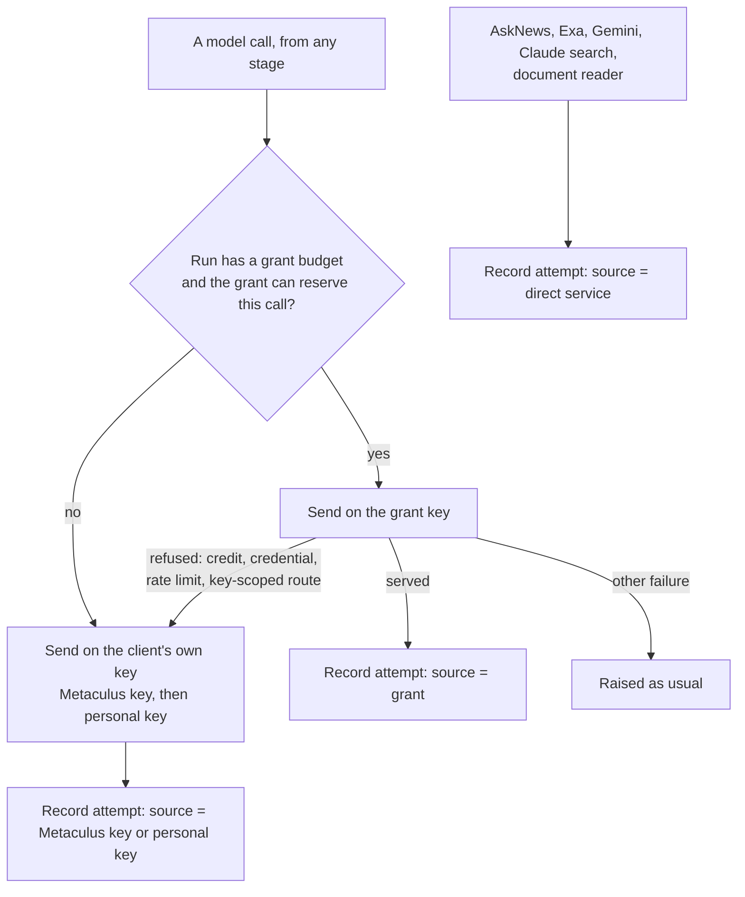

# Funding and spend accounting

There is one forecasting pipeline. Who pays for a call changes which credential carries
it, never the models, research, retries or publication rules. Every run records each
paid call in a local spend ledger, and a run can let the OpenRouter grant pay before the
ordinary keys.



## Running with the grant

```bash
python -m sibyl test --tier prod --grant-budget-usd 10
```

`--grant-budget-usd` is the most this run may hold against the grant. It is refused on
the free tier, and it needs `SIBYL_EXPERIMENT_OPENROUTER_API_KEY` set to a key distinct
from `OPENROUTER_API_KEY` and `OAI_ANTH_OPENROUTER_KEY`. Before the first question, the
run reads the grant key's OpenRouter settings (no model request) and refuses to start
unless the key has a finite cap of at most $100 that includes BYOK spending, does not
reset periodically, and has enough left for the budget plus a $5 reserve.

Add `--run-id <name>` and `--archive-dir backtests/minibench_runs` to keep the run's
manifest, selected questions and reports in the layout `python -m sibyl.eval
minibench-live` scores. The same command shape works for every mode. A publishing or paid run still needs the
operator's approval for that specific run (AGENTS.md cost rules).

**How the grant complements the ordinary keys.** Each OpenRouter attempt is offered to
the grant first. The grant holds `--grant-reserve-per-call-usd` (default $2) for the
attempt until its charge is known, and stops being offered for the rest of the run when:

- the run budget or the local $100 allocation (less its $5 reserve) cannot cover the hold;
- OpenRouter refuses the grant key for credit or credentials;
- a single charge exceeds the per-call hold.

A rate limit or key-scoped route refusal moves only that request. Any other failure is
raised exactly as it would be without a grant, so the payer never adds a retry.

## What is recorded

Every run, with or without a grant, writes to `SIBYL_SPEND_LEDGER` (default
`backtests/experiment_grant_spend.sqlite3`, private and outside Git). Each attempt has a
run ID, question, stage, model or service, the source that paid (`experiment-grant`,
`metaculus-key`, `personal-key`, `direct-service`), its status and its charge. The run
log ends with one `SPEND_SUMMARY` line per source, which the telemetry archive harvests
from CI logs (the per-attempt `SPEND_ATTEMPT` lines are not archived).
If the ledger cannot be opened, an ordinary run continues unaccounted and says so; a
grant run refuses to start.

**Charges.** A charge is *confirmed* only when OpenRouter reported every part of it: the
fee, and on a BYOK route the upstream cost as well. The response usually carries both.
Anything less is an *estimate*, and a grant estimate keeps its whole hold until it is
reconciled. Direct services return no per-call charge, so their attempts are recorded at
an estimated $0 and are priced from the service's own invoice. A request OpenRouter
turned away before the model ran (a 4xx: bad request, key or credit problem, moderation,
missing model, rate limit) costs nothing and releases its hold. A grant attempt that
timed out, was cancelled or failed upstream may have been billed and has no billing
record to look up, so it keeps its hold until it is written off (below).

## Inspecting and reconciling

```bash
python -m sibyl.ops.experiment_grant report --run-id <run-id>
python -m sibyl.ops.experiment_grant reconcile --run-id <run-id>
```

`report` shows totals per source and calls grouped by source, model and stage, without
prompts or credentials. It also shows the totals of the separate fallback table older
versions wrote, when the ledger has one.

`reconcile` reads OpenRouter's billing record for each estimated attempt, using the key
that made the request (so it needs that source's key in the environment). It is
read-only, retries a record that is not visible yet, and exits 1 while anything can still
be confirmed or written off, and 2 when a source's key is missing. An ordinary-key
attempt with no generation ID holds no budget and nothing can price it, so it stays in
the report without failing `reconcile`. Every command refuses a ledger path that does not
exist rather than creating one.

If grant credits were spent outside the ledger, count them against the allocation:

```bash
python -m sibyl.ops.experiment_grant record-prior-spend \
  --id outside-001 --amount-usd 4.25 --note 'previous grant use'
```

Grant attempts that can never be reconciled (no generation ID, for example a call lost
after sending) can be replaced by what OpenRouter metered for them. The command refuses
unless exactly the expected number of attempts match:

```bash
python -m sibyl.ops.experiment_grant write-off \
  --provider-total-usd 0.80 --expect-count 8 \
  --note 'OpenRouter activity, 2026-10-05' --id trueup-2026-10-05
```

## Limits

- The local hold is accounting, not a provider cap. The grant key's own OpenRouter cap is
  what OpenRouter enforces; a request past it is refused and moves to the ordinary keys.
- If responses stop carrying the full charge, every grant attempt keeps its $2 hold until
  `reconcile` runs, and the grant budget runs out far sooner than the money spent.
- The backtest and ablation CLIs do not open a ledger and do not use the grant.
